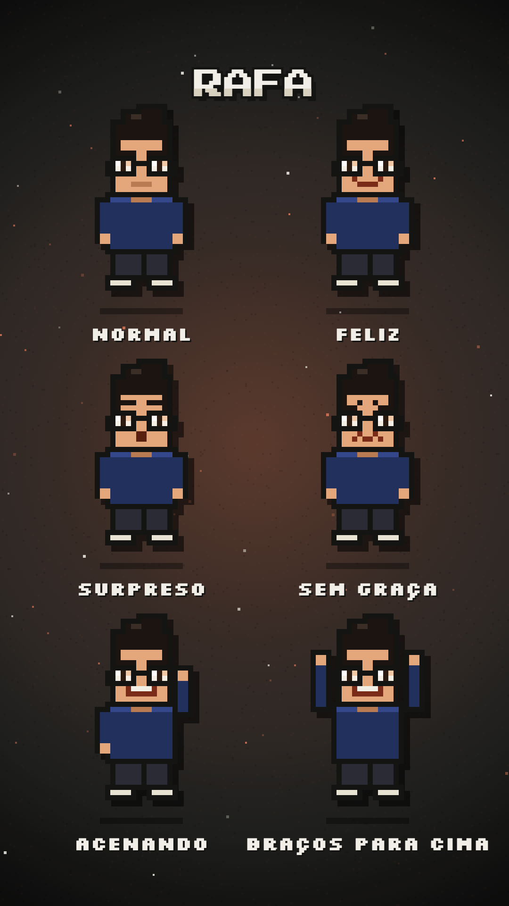

# Pixel Reels

Skill para o [Claude Code](https://claude.com/claude-code) que cria Reels verticais animados em pixel art, do roteiro à pasta de entrega.

Você pede o vídeo, e uma equipe de agentes faz o resto:

| Agente | O que faz |
|---|---|
| **Roteirista** | Pesquisa os fatos e escreve gancho, desenvolvimento e finalização |
| **Personagem** | Cria o seu personagem em pixel art a partir de uma descrição ou foto |
| **Produtor** | Anima as cenas sincronizadas com cada palavra, cria os efeitos sonoros e a capa |
| **Revisor** | Procura erros de forma independente e reprova o vídeo até ficar bom |



## Instalação

Você precisa de Claude Code, Node 22+, Python 3, ffmpeg e Google Chrome.

```bash
git clone https://github.com/deoliverrafa/pixel-reels ~/.claude/skills/pixel-reels
~/.claude/skills/pixel-reels/scripts/setup.sh
```

Edite `~/.config/pixel-reels/config.json` com o seu perfil, a sua série e as suas cores.

## Como usar

No Claude Code:

```
/pixel-reels faça um vídeo explicando como criar uma skill no Claude
```

Ou peça com as suas palavras: "cria um Reel em pixel art sobre X". Se quiser usar a sua voz, grave o áudio e passe o arquivo:

```
/pixel-reels anima este áudio: ~/Downloads/minha-gravacao.m4a
```

Para criar um personagem:

```
/pixel-reels cria meu personagem: cabelo cacheado, óculos redondos, camiseta verde
```

## O que você recebe

- Vídeo 1080x1920 e cópia menor para celular
- Capa e descrição do post
- Efeitos sonoros separados para editar no CapCut
- Narração

## Narração com a sua voz (opcional)

Precisa de uma conta paga no [ElevenLabs](https://elevenlabs.io) para clonar a voz. Salve a chave com permissão restrita e coloque o ID da voz no config:

```bash
pbpaste > ~/.elevenlabs_key && chmod 600 ~/.elevenlabs_key
```

Clone só a sua própria voz ou a de alguém que autorizou. Ao postar, ative o rótulo de conteúdo de IA da plataforma. Sem ElevenLabs, basta gravar o áudio no celular.

## O verificador de texto

`scripts/audit_text.py` percorre o vídeo inteiro e mede cada texto desenhado. Ele aponta o que sai da caixa, sai do quadro, fica fora da zona segura ou está pequeno demais. Isso pega erros que uma revisão visual rápida deixa passar.

## Personalização

- **Cores:** `estilo` no config
- **Personagens:** arquivos em `characters/`
- **Agentes:** instruções em `references/agents/`
- **Regras de estilo, áudio e capa:** `references/`

## Limites

- Os vídeos são animados por código, então cada vídeo consome uso do Claude Code. Vídeos com vários agentes consomem bem mais do que uma conversa comum.
- Confira sempre os fatos e os passos antes de publicar. Menus de produtos mudam.

## Créditos e licença

Código sob [licença MIT](LICENSE). Fontes Press Start 2P e Silkscreen sob [SIL Open Font License](templates/project/assets/fonts). Renderização com [HyperFrames](https://www.npmjs.com/package/hyperframes), baixado na hora de usar e sujeito à licença dele.

Projeto independente de [@aprendaclaude](https://instagram.com/aprendaclaude). Não é oficial e não tem vínculo com a Anthropic.
